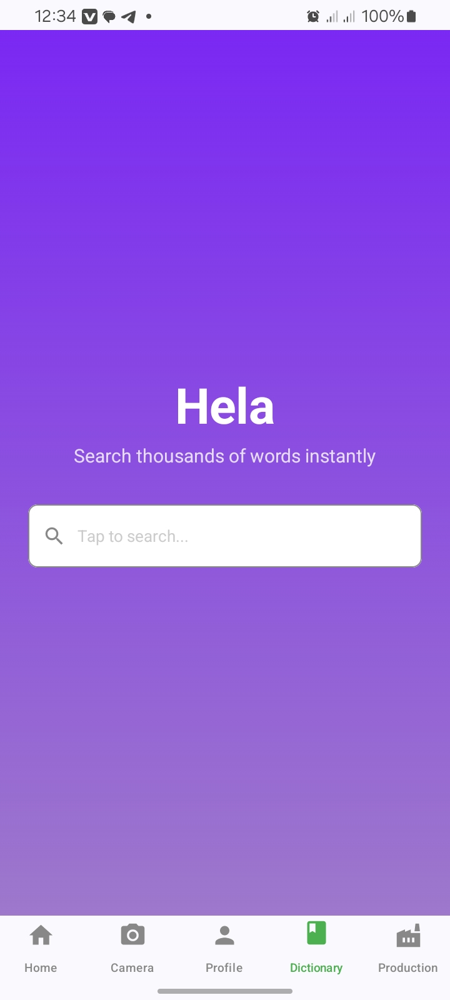
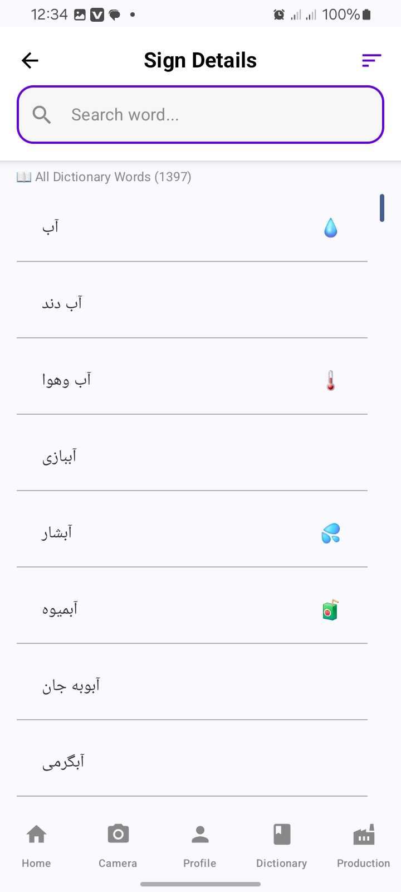

# Sign Language Dictionary App 🤟

**Hela** is an Android application that makes sign language accessible to the Deaf and hard-of-hearing community in Afghanistan. It provides a searchable Persian/Dari sign language dictionary where every word is illustrated with a short sign-language video, and it can even translate spoken or typed Persian sentences into a sequence of sign videos in real time.

> The app ships with **1,397 dictionary words** and **2,000+ bundled sign-language videos**, organized across categories such as religion, family, body organs, clothing, household items, fruits, school, animals, nature, transportation, cities, emotions, verbs, and more.

---

## 📱 Screenshots

| Dictionary Home | Sign Details / Word List |
|---|---|
|  |  |

---

## 🎯 Use Cases

### 1. Instant Word Lookup
Search thousands of Persian words instantly from the main dictionary screen. Selecting a word opens the **Sign Details** screen, which plays a pre-recorded video of the corresponding sign, shows a related emoji,c/6af3f028-7148-83ea-866d-9369cddf8ccd and suggests related words.

### 2. Speech-to-Sign Translation (Production Screen)
Type or dictate a full Persian sentence using **Android Speech Recognition**, and the app:
1. Tokenizes the text with a custom **Persian text processor** (multi-word token detection, stop-word removal, and stemming).
2. Maps each token to its sign-language video.
3. Plays the signs back-to-back as a complete signed "sentence."

### 3. Camera Capture (Learning Module)
A CameraX-powered capture screen lets users record/take images of themselves practicing signs. Captured images are processed (resized to 224×224 for future ML model input) and saved locally — laying the groundwork for sign-recognition feedback.

### 4. Profile
A simple user profile screen with editable details.

---

## 🏗️ Architecture

The project follows a modern, single-module Android architecture built around **Jetpack Compose**, **MVVM**, and **unidirectional data flow with Kotlin StateFlow**.

```
app/src/main/java/com/mustafa/project001/
│
├── MainActivity.kt              # Single-activity entry point (edge-to-edge, theme, NavHost)
├── navigation/                  # Navigation layer
│   ├── NavRoute.kt              # Type-safe route definitions
│   ├── NavItem.kt               # Bottom-nav items (icon + label + route)
│   └── BottomNavigationBar.kt   # Material 3 bottom navigation bar
│
├── ui/
│   ├── screens/                 # Top-level composable screens
│   │   ├── HomeScreen.kt        # Home dashboard
│   │   ├── DictionaryScreen.kt  # Search entry ("Hela" home)
│   │   ├── SingleWordSign.kt    # Sign details: video player + related words + categories
│   │   ├── SearchScreen.kt      # Browse all dictionary words
│   │   ├── ProductionScreen.kt  # Speech/text → sign video sequence
│   │   ├── CameraScreen.kt      # CameraX capture + permission handling
│   │   └── ProfileScreen.kt     # User profile
│   ├── components/              # Reusable composables (search rows, bottom sheets,
│   │                            #   permission rationale/denied screens, sign player)
│   └── theme/                   # Material 3 theme, colors, typography
│
├── viewmodel/
│   └── CameraViewModel.kt       # MVVM view model exposing StateFlow for camera
│                                #   capture state, processing progress, bottom-sheet state
│
├── data/                        # Local data sources
│   ├── getDictionaryData.kt     # Master word list (~1,400 Persian words)
│   ├── VideoMap.kt              # Word → raw sign-video resource mapping
│   ├── EmojiMapTo.kt            # Word → emoji mapping
│   └── getRelatedWords.kt       # Category-based related words
│
└── utils/
    ├── PersianTextProcessor.kt  # Persian NLP: multi-word tokens, stop words, stemming
    └── getDictionarySearchFlow.kt  # Debounced search flow
```

### Architecture Highlights

- **Single Activity, Compose-only UI** — All screens are Composables hosted in a `NavHost` with a Material 3 `Scaffold` and bottom navigation bar (`MainActivity.kt:62`).
- **MVVM** — `CameraViewModel` holds UI state as `StateFlow` (captured image, processing progress, bottom-sheet state), collected from Composables via `collectAsState()`.
- **Offline-first data layer** — The dictionary, emoji map, video map, and related-word categories are plain Kotlin data files. Sign videos are bundled as **2,000+ raw `.mp4` resources** and streamed via `android.resource://` URIs into `VideoView` — no network required.
- **Navigation by URL-decoded route args** — The `singleWord/{word}` route passes the (URL-encoded) Persian word to the details screen.

### Data Flow (Speech → Sign)

```
User speech/typed text
        │  (Android Speech RecognizerIntent)
        ▼
PersianTextProcessor.processText()
  ├─ extractMultiWordTokens()   → matches long phrases first ("ختم قران شریف")
  ├─ stop-word filtering        → removes "از", "به", "در", ...
  └─ stemming                   → strips suffixes ("ترین", "ها", ...) and "می‌" prefix
        ▼
List<tokens>  ──lookup──►  VideoMap  ──►  android.resource://…/raw/*.mp4
        ▼
VideoView plays tokens sequentially as a signed sentence
```

---

## 🔑 Key Dependencies

| Dependency | Purpose |
|---|---|
| **Jetpack Compose** (BOM `2024.09.00`, Material 3 `1.4.0`) | Declarative UI toolkit; entire UI is Compose |
| **Kotlin 2.0.21** + Compose compiler plugin | Language & Compose compiler |
| **AndroidX Navigation Compose `2.9.7`** | In-app navigation between screens |
| **Lifecycle ViewModel Compose `2.10.0`** | MVVM view models accessible from Composables |
| **CameraX `1.5.3`** (core, camera2, lifecycle, view) | Camera preview and image capture |
| **Accompanist Permissions `0.35.0-alpha`** | Runtime camera-permission handling with rationale UI |
| **Accompanist System UI Controller `0.36.0`** | Edge-to-edge status/system bar theming |
| **Accompanist Pager Indicators `0.32.0`** | Tab/pager indicator animations |
| **Coil Compose `2.5.0`** | Async image loading |
| **Material Icons Extended** | Extended icon set for the UI |
| **AndroidX Core KTX `1.17.0` / Activity Compose `1.12.3`** | Core Android + Compose Activity integration |
| **Google Ads Mobile SDK `1.0.1`** | Ad support (declared in version catalog) |
| **Android Speech Recognition (`RecognizerIntent`)** | Voice input for the Production screen (platform API) |

Build tooling: **AGP 8.13.2**, **Gradle version catalog** (`gradle/libs.versions.toml`), `compileSdk 36`, `minSdk 24`, `targetSdk 35`, JVM target 11.

---

## 🚀 Getting Started

### Prerequisites
- Android Studio (AGP 8.13.2 compatible)
- Android SDK 36
- A device/emulator running **Android 7.0 (API 24)** or higher with a camera

### Build & Run

```bash
# Clone the repository
git clone <repo-url>
cd Android-Sign-App

# Build debug APK
./gradlew assembleDebug

# Install on a connected device
./gradlew installDebug
```

Open the project in Android Studio and press **Run ▶** to launch on a device.

### Permissions
- **Camera** — requested at runtime (with rationale and denied states) for the capture screen.

---

## 📂 Project Structure Notes

- Sign videos live in `app/src/main/res/raw/` (2,000+ `.mp4` files) and are referenced by `VideoMap.kt`.
- The Persian dictionary and category lists live in `data/getDictionaryData.kt` and `data/getRelatedWords.kt`.
- The camera pipeline (capture → resize to 224×224 → save to internal storage) is prepared for a future **on-device sign-recognition ML model**.

---

## 📄 License

This project is developed to support the Afghan Deaf community. Add your license of choice here.
